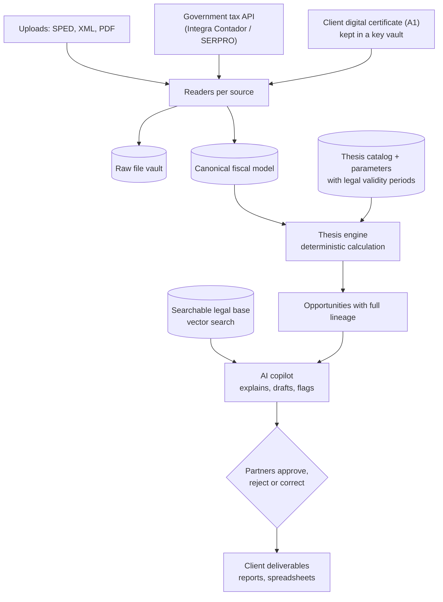

# R2Trib — AI tax recovery and optimization platform (Brazil)

> **Showcase repository.** The source code is private; this page documents what the platform does and how it is built.
> Built by [Roderick Specter](https://github.com/rodcoding123), technology partner.

R2Trib automates the work of a Brazilian tax recovery firm. Today that work is manual: analysts review 5 to 7 years of a company's taxes, invoices and sales looking for overpaid taxes, unused credits and better tax regimes. R2Trib replaces the search and the calculation. The partners (tax accountant, customs specialist, tax lawyer) keep the final word: **nothing reaches a client without their approval**, and every number is traceable to its source line.

---

## At a glance

| | |
|---|---|
| **Build pace** | 849 commits in about two weeks |
| **Codebase** | ~3,000 code files, ~325,000 lines |
| **Tests** | 900+ test files (unit, database, storage, vector search, visual, end-to-end, performance) |
| **Data handled** | SPED fiscal files (EFD-Contribuições, EFD ICMS/IPI, ECF, ECD), NF-e/NFC-e XML, PDFs, government APIs |
| **Performance target** | A mid-size case with up to 5 million SPED lines screened in under 30 minutes |

---

## How it works

### Design principles
- **Deterministic numbers, AI for hypotheses**: every value comes from a versioned thesis with deterministic calculation; the AI layer explains, searches the law and proposes hypotheses, but never invents numbers
- **Full lineage**: every value in every deliverable traces back to the thesis and version used, its parameters, and the original file and line
- **Reproducible**: reprocessing a closed case produces an identical result
- **Measured quality**: planted-scenario test suites must find every planted opportunity, flag no noise and match the expected value to the cent; input-classification precision gates approval (default 95%)
- **Humans in the loop**: analysts and partners only approve, reject or correct

## Scope (sub-projects)

1. Core platform
2. Mid-size companies (presumed and real profit regimes): SPED and government API; payroll and social security contributions
3. Simples Nacional: NF-e/NFC-e XML and PGDAS-D
4. Searchable legal base with change monitoring
5. Discovery layer: an agent that generates new hypotheses
6. Individual taxpayers (CPF)
7. Foreign trade (import/export)
8. Commercial: prospecting with open company data, contracts, success-fee control and client portal
9. Tax reform (IBS/CBS) transition and planning
10. Production in Brazil: dedicated server, key vault and object storage

## Security
- Client digital certificates and secrets in a **key vault** (AWS KMS envelope encryption, key splitting, rotation and wrapping tools, vault sentinel)
- Development and testing only with **synthetic data**; real data only on a dedicated server in Brazil
- XML digital-signature verification, strict file parsing, role-based access

---

## Tech stack

| Layer | Technology |
|---|---|
| App | Nuxt 4 + Nitro (TypeScript), Vue 3, Tailwind 4, Reka UI |
| Data | Supabase Postgres (self-hosted), postgres.js, pg-boss job queue |
| Precision | decimal.js for money, exact rounding rules |
| Files | SPED and XML parsers (saxes, xmldom, xml-crypto), pdf.js, ExcelJS, streaming uploads |
| AI | Anthropic Claude (copilot, prompt evaluation suite), vector search over tax law |
| Security | AWS KMS, S3-compatible storage, JOSE |
| Quality | Vitest (unit, DB, S3, vectors, performance, visual), E2E user flows |

---

## What this project shows

- Turning a manual, expert-heavy professional service into software, with the experts kept in control
- Financial and legal correctness: traceability, reproducibility and cent-exact calculation
- Responsible AI: the model assists, the deterministic engine decides the numbers

---

Reach me through my [GitHub profile](https://github.com/rodcoding123) or Upwork.
